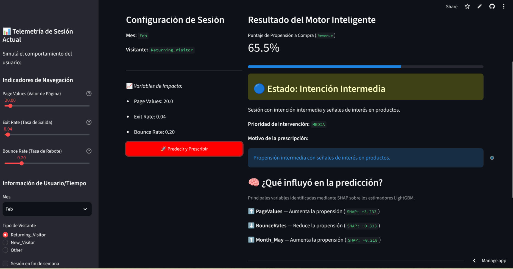

<!--
PENDIENTE: reemplazar la imagen de abajo por una captura real de la app de
Streamlit (assets/demo.png) — ver MovieTime/CreditFlow como referencia de formato.
Borrar este comentario antes de commitear.
-->

<div align="center">

# 🛒 Metric Mindset

**Sistema de scoring de intención de compra y motor de recomendaciones para e-commerce**, construido end-to-end: EDA → modelado calibrado → API → app interactiva → deploy.


[](https://proyecto-final-henry-cgwmikv2ykhrmpytpuv8hy.streamlit.app/)

</div>

<br>

<div align="center">
  
</div>

<br>

## 📑 Contenido

- [El problema, en una escena](#-el-problema-en-una-escena)
- [Mi rol y aportes](#-mi-rol-y-aportes-juan-manuel--data-scientist)
- [Demo en vivo](#-demo-en-vivo)
- [Qué hace](#-qué-hace)
- [Pipeline de datos y modelado](#-pipeline-de-datos-y-modelado)
- [Instalación y ejecución](#-instalación-y-ejecución)
- [Ejemplo de uso de la API](#-ejemplo-de-uso-de-la-api)
- [Cómo está construido](#-cómo-está-construido)
- [Insights de negocio](#-insights-de-negocio)
- [Recursos útiles](#-recursos-útiles)
- [Próximos pasos](#-próximos-pasos)
- [Licencia](#-licencia)
- [Equipo](#-equipo)

---

## 🎬 El problema, en una escena

Un usuario entra a una tienda online, navega ocho minutos, mira cinco productos, agrega uno al carrito... y se va sin comprar. Pasa en **8 de cada 10 sesiones**, y el negocio no se entera hasta que ya es tarde para intervenir.

**Metric Mindset** responde una pregunta simple: *¿podemos anticipar esa decisión mientras la sesión todavía está ocurriendo, y decirle al negocio qué hacer al respecto?*

Lo construí como proyecto final del bootcamp de Data Science de Henry porque quería llevar un modelo más allá del notebook: calibrado, con una API real, una demo usable y desplegado — no solo una métrica en un Jupyter Notebook. Ahí está la diferencia frente a un proyecto de clasificación típico: no se queda en "esta sesión tiene 83% de probabilidad de compra", la traduce en una **acción de negocio concreta** (cross-selling, retención o ninguna acción) mediante umbrales calibrados.

---

## 🙋 Mi rol y aportes (Juan Manuel — Data Scientist)

El equipo fue de 4 personas (ver [Equipo](#-equipo)); mi parte, según el historial real de commits del repo, cubrió el ciclo completo:

- **Datos → Modelo:** ingesta y validación (`data_loader.py`), EDA propio + consolidación con el de un compañero, pipeline de ETL, feature engineering de comportamiento de sesión.
- **Modelado:** el MVP del Sprint 1, y en el Sprint 2 el tuning con Optuna, tratamiento del desbalance (SMOTE / `class_weight`) y la calibración de probabilidades — la pieza de mayor impacto (bajó el Brier Score ~33%).
- **Motor de recomendaciones:** `asignar_accion()`, la lógica que convierte probabilidad en acción de negocio.
- **Productivización:** API completa en FastAPI, conexión de la app Streamlit al modelo real, CI con GitHub Actions, tracking con MLflow, y el despliegue (Render + Streamlit Cloud).
- **Testing y documentación:** smoke tests de la API y gran parte de este README.

Lo que más me dejó el proyecto: la mitad del trabajo de un modelo "bueno" no es el algoritmo, es lo que pasa después de entrenarlo — calibrarlo, exponerlo, y hacer que alguien sin conocimientos técnicos pueda usarlo.

---

## 🚀 Demo en vivo

- **App (Streamlit):** [proyecto-final-henry-cgwmikv2ykhrmpytpuv8hy.streamlit.app](https://proyecto-final-henry-cgwmikv2ykhrmpytpuv8hy.streamlit.app/)
- **API (FastAPI):** desplegada en Render (ver `render.yaml`)

> Corren en planes gratuitos y pueden tardar 30-60s en "despertar" tras inactividad.

---

## ✨ Qué hace

1. 📊 Analiza el comportamiento de una sesión (páginas vistas, tiempo, rebotes).
2. 🎯 Estima la probabilidad de compra (score 0-1) con un LightGBM calibrado.
3. ⚡ Recomienda una acción según umbrales de negocio:

| Probabilidad | Acción | Tasa real de compra observada |
|---|---|---:|
| > 70% | Cross-selling | 85,9% |
| 30% – 70% | Sin acción | 44,9% |
| < 30% | Retención | 4,9% |

**Resultado del modelo final** (LightGBM + Optuna + calibración sigmoid, sobre test set): ROC-AUC 0,938 · PR-AUC 0,756.

**Evaluación por ranking** — si el negocio solo puede intervenir sobre una porción de las sesiones, el modelo permite priorizar cuáles:

| Top K | Precision@K | Recall@K |
|---:|---:|---:|
| 5% | 86% | 27% |
| 10% | 80% | 51% |
| 20% | 60% | 77% |
| 30% | 47% | 91% |

Con capacidad para intervenir sobre el 10% de las sesiones, ~8 de cada 10 seleccionadas terminan en compra, capturando la mitad de todas las ventas del período — permite dimensionar campañas según presupuesto.

---

## 🔬 Pipeline de datos y modelado

**EDA:** sin valores nulos, pero con 125 duplicados efectivos. Los outliers detectados por IQR se conservaron a propósito — representan comportamientos reales de navegación, no errores de carga. Variables más correlacionadas con `Revenue`: `PageValues`, `ExitRates`, `ProductRelated`, `Month`.

**Feature engineering** — variables derivadas del comportamiento de sesión:

| Feature | Qué mide |
|---|---|
| `duracion_total` | Suma del tiempo en páginas administrativas, informativas y de producto |
| `paginas_totales` | Cantidad total de páginas visitadas en la sesión |
| `duracion_promedio_pagina` | Tiempo promedio de navegación por página |
| `proporcion_paginas_producto` | Proporción de la sesión dedicada a páginas de producto |
| `es_visitante_recurrente` | Derivada de `VisitorType` |

**Preprocesamiento:** split estratificado 80/20 (9.764 sesiones train / 2.441 test, `random_state=42`), `OneHotEncoder` para categóricas y `StandardScaler` para numéricas — ambos ajustados solo sobre train para evitar data leakage.

**De MVP a modelo final:** el Sprint 1 comparó Regresión Logística, Random Forest y XGBoost (Random Forest ganó con ROC-AUC 0,924). El Sprint 2 llevó esa base a LightGBM + Optuna + calibración sigmoid — la combinación que terminó en producción.

---

## 🔧 Instalación y ejecución

```bash
git clone https://github.com/Juanma-Alvarado/MetricMindset.git
cd MetricMindset
python -m venv venv && source venv/bin/activate   # Windows: .\venv\Scripts\activate
pip install -r requirements.txt

uvicorn api.main:app --reload        # API en http://localhost:8000/docs
streamlit run demo_app.py            # App en http://localhost:8501
```

Los artefactos del modelo ya están versionados en el repo — no hace falta reentrenar para probar la API o la app.

---

## 🔌 Ejemplo de uso de la API

```http
POST /predict
```

```json
{
  "ProductRelated": 25,
  "ProductRelated_Duration": 620.5,
  "BounceRates": 0.01,
  "ExitRates": 0.02,
  "PageValues": 35.0,
  "Month": "Nov",
  "VisitorType": "Returning_Visitor",
  "Weekend": false
}
```

```json
{
  "purchase_probability": 0.83,
  "recommended_action": "cross_selling"
}
```

Contrato completo y documentación interactiva (Swagger) en `/docs` una vez levantada la API.

---

## 🏗️ Cómo está construido

| Capa | Tecnologías |
|---|---|
| Datos & Análisis | Python, Pandas, NumPy, Power BI |
| Machine Learning | Scikit-Learn, LightGBM, XGBoost, CatBoost, Optuna, Imbalanced-learn |
| Backend | FastAPI, Pydantic, Uvicorn |
| Frontend | Streamlit |
| MLOps | MLflow, GitHub Actions, deploy en Render + Streamlit Cloud |

**Dataset:** *Online Shoppers Intention* (UCI Machine Learning Repository) — 12.330 sesiones, fuerte desbalance (84,5% no compra). Tras limpieza: 12.205 filas × 30 columnas, incluyendo features derivadas de navegación.

**Arquitectura:**

```text
Sesión → Feature Engineering → LightGBM calibrado → Probabilidad → Motor de recomendación → Acción
```

**La pieza clave del modelo** — calibrar las probabilidades para que los umbrales de negocio sean confiables:

```python
CalibratedClassifierCV(method="sigmoid", cv=3)
# Brier Score: 0.101 (sin calibrar) → 0.068 (calibrado)
```

```text
api/            → endpoints FastAPI (main, routes, schemas, inference)
src/            → data_loader, preprocessing, features, metrics, recommender
notebooks/      → EDA, ETL, feature engineering, modelado (MVP y avanzado)
data/           → raw, processed, models
tests/          → smoke tests de la API
demo_app.py     → app Streamlit
```

---

## 💡 Insights de negocio

- **Estacionalidad:** el volumen de compras crece hacia fin de año, con picos en noviembre y diciembre — útil para planificar campañas, stock e infraestructura.
- **Usuarios nuevos vs. recurrentes:** los nuevos convierten más que los recurrentes, aunque estos últimos son la mayoría del tráfico — abre una oportunidad concreta de retención.
- **Señales más fuertes:** `PageValues`, `ExitRates` y `ProductRelated_Duration` son, de lejos, las variables más predictivas de intención de compra.

---

## 📚 Recursos útiles

- Dataset: *Online Shoppers Purchasing Intention* — UCI Machine Learning Repository
- [Documentación de Optuna](https://optuna.readthedocs.io/)
- [CalibratedClassifierCV — scikit-learn](https://scikit-learn.org/stable/modules/generated/sklearn.calibration.CalibratedClassifierCV.html)

## 🔮 Próximos pasos

Llevar el sistema a un entorno cloud productivo, A/B testing de las estrategias de intervención, y monitoreo de drift del modelo.

## 📄 Licencia

Proyecto desarrollado con fines académicos como parte del proyecto final de Ciencia de Datos de Henry.

## 👥 Equipo

| Integrante | Rol |
|---|---|
| Camila Conde | Team Lead / Product Owner & Scrum Master |
| Luis | Data Engineer & Analytics |
| **Juan Manuel** | Data Scientist |
| Lucas Bottino | Data Scientist |

Repo original del equipo: [lucasbottino9/Proyecto-Final-Henry](https://github.com/lucasbottino9/Proyecto-Final-Henry) — este repositorio es mi fork, con mi aporte documentado arriba.

---

**Metric Mindset** — de los datos a la decisión, de la intención a la conversión.
